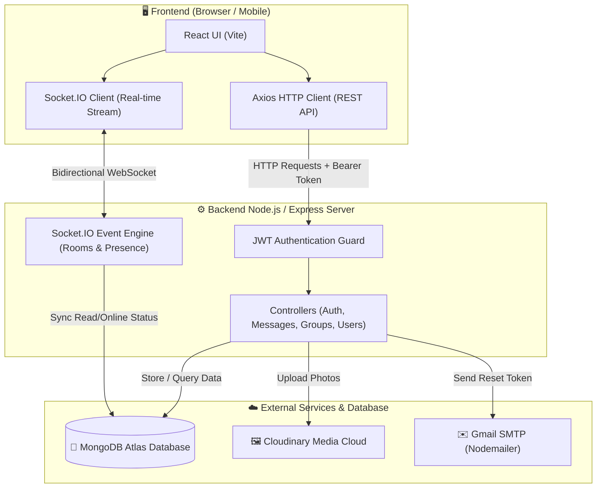

# 💬 ChatSphere — Enterprise Real-Time Chat Application

<p align="center">
  
  
  
  
  
</p>

---

## 🌟 1. Project Overview (For Everyone — Non-Technical Summary)

### What is ChatSphere?
Imagine **WhatsApp or Slack**, but built completely from scratch using modern web technologies. **ChatSphere** is a fast, secure, real-time messaging platform where people can:
- Chat one-on-one with friends instantly without refreshing the page.
- Create group conversations with custom names and add multiple members.
- Share high-resolution photos and avatars stored safely in the cloud.
- See who is online in real-time, who is currently typing, and when someone was last active.
- Know exactly when a message is **Sent (✓)**, **Delivered (✓✓)**, or **Read (Cyan ✓✓)**.
- Securely recover lost accounts through instant email reset tokens.

### The Everyday Analogy: How It Works
Think of ChatSphere like a modern digital courier service:
1. **The User (Sender):** Types a letter (message) on their screen.
2. **The Post Office (Backend Server):** Receives the letter, checks your digital ID badge (JWT token) to verify who you are, stamps the letter with a timestamp, and saves an official copy in the safe vault (MongoDB Database).
3. **The Instant Radio Hotline (Socket.IO):** Instead of waiting for traditional mail delivery, an open instant wire pushes the letter to the receiver's phone or screen within milliseconds.
4. **The Photo Locker (Cloudinary):** If you attach a heavy picture, it isn't stuffed into the mailbox. It's stored in a secure cloud photo locker, and only a lightning-fast photo link is shared in the chat.
5. **The Mail Carrier (Nodemailer / Gmail):** If you ever forget your password, our automated courier flies an official security code directly to your private email address.

---

## 💡 2. Why I Built This Project (Motivation & Vision)

Every day, billions of people casually open WhatsApp, Slack, or Discord without thinking about what happens behind the screen. As a passionate developer, I didn't just want to be a *consumer* of great technology — **I wanted to understand how it truly works under the hood.**

Building **ChatSphere** was driven by three core motivations:

1. **Moving Beyond Basic CRUD Applications:**
   * Most beginner projects are simple Todo apps or e-commerce clones that only fetch and save data upon page refresh.
   * I wanted to tackle the real challenges of modern software engineering: **bi-directional real-time event streaming**, WebSocket connection lifecycles, and managing distributed socket state across multiple tabs.

2. **Mastering Real-World Distributed Data Flow:**
   * I wanted hands-on mastery over how diverse technologies communicate harmoniously in production:
     * How to keep a MongoDB database cleanly synchronized with live WebSockets.
     * How to offload binary image media to Cloudinary cloud pipelines so the server doesn't choke on file streams.
     * How to handle zero-trust security: encrypting passwords with Bcrypt and securing REST endpoints with JWT authorization guards.

3. **Engineering a Portfolio-Grade, Production-Ready Product:**
   * Rather than building a half-finished demo with dummy buttons, I committed to building an end-to-end usable product — complete with group management, read receipts (✓ / ✓✓ / Cyan ✓✓), typing indicators, automated SMTP password recovery emails, and responsive mobile navigation.
   * This project reflects my dedication to clean architectural design, structured code modularity, and delivering an intuitive user experience.

---

## 🛠️ 3. Tech Stack Explained in Simple Words

| Technology | What it is | Why we use it (In Plain English) |
| :--- | :--- | :--- |
| **React 19 (Frontend)** | User Interface Library | Builds the buttons, chat bubbles, sidebar, and popups that the user sees and clicks. |
| **Vite** | Frontend Build Tool | Bundles the website code super fast so it loads in the browser with zero lag. |
| **Node.js & Express (Backend)** | Server Engine | The brain of the app that receives user requests, checks passwords, runs business logic, and talks to the database. |
| **Socket.IO** | Real-time Two-way Channel | Keeps a permanent live bridge open between users so messages pop up in under 50ms without hitting "refresh". |
| **MongoDB Atlas** | Cloud Database | The permanent digital filing cabinet where users, message logs, group lists, and timestamps are safely stored. |
| **Cloudinary** | Cloud Media Storage | An optimized image CDN that resizes, compresses, and safely stores uploaded chat photos and profile pictures. |
| **Nodemailer** | Email Delivery Engine | Connects our backend to Gmail SMTP servers to deliver password reset tokens directly to user inboxes. |
| **JSON Web Tokens (JWT)** | Digital Security Badge | A tamper-proof encrypted digital pass given to a user when they log in, proving their identity on every request. |
| **Bcrypt.js** | Password Hasher | Turns passwords into unhackable scrambled mathematical strings before storing them in the database. |

---

## 🗺️ 4. Complete Data Flow & Architectural Workflow

### High-Level Architecture Diagram



---

## 🔄 5. Feature Workflows: Where Data Comes From, Goes, & Stores

### Flow A: User Registration & Login (Authentication)
1. **Input:** User fills in their Name, Email, and Password.
2. **Frontend:** React sends a `POST /api/auth/signup` request with JSON data.
3. **Backend:**
   - Express checks if the email already exists in MongoDB.
   - `bcrypt.hash()` scrambles the password with 10 salt rounds.
   - Saves the user document in MongoDB.
   - Generates a signed **JWT (JSON Web Token)** containing the user's ID.
4. **Storage:**
   - Password is stored hashed in MongoDB (`users` collection).
   - JWT token is saved in the browser's `localStorage`.
5. **Output:** The user is logged in automatically and redirected to the `/chat` dashboard.

---

### Flow B: Sending a Real-Time Chat Message
1. **Input:** User types `"Hey, are you free?"` and hits Send.
2. **Frontend:** React does two things:
   - Immediately adds an optimistic message bubble in the UI for instant feedback.
   - Sends a `POST /api/messages` request to the backend with recipient ID and message text.
3. **Backend:**
   - Saves the message in MongoDB (`messages` collection) with `status: "sent"`.
   - Emits a real-time WebSocket event: `io.to(recipientSocketId).emit("new_message", savedMessage)`.
4. **Recipient:**
   - The recipient's active browser receives the socket event instantly.
   - The message bubble pops onto their screen with sound/badge.
   - If they have the chat open, a `mark_messages_read` event is emitted back, flipping the checkmarks to **Read (Cyan ✓✓)** on the sender's screen.

---

### Flow C: Uploading & Sharing Images in Chat
1. **Input:** User clicks the 📎 paperclip icon and picks a photo (JPEG, PNG, WEBP).
2. **Frontend:** Packages the binary file inside a `FormData` object and posts to `/api/messages/upload-image`.
3. **Backend Processing:**
   - `Multer` intercepts the file in memory buffer (no risky temporary files left on disk).
   - File buffer streams directly to **Cloudinary API**.
   - Cloudinary optimizes, compresses, and returns an HTTPS URL (`https://res.cloudinary.com/...`).
   - The backend saves a new message document in MongoDB with `imageUrl: secure_url`.
4. **Real-time broadcast:** Socket.IO pushes the new image message to the recipient's screen.
5. **UI Display:** Clicking the image opens a clean full-screen interactive lightbox viewer.

---

### Flow D: Group Creation & Group Chatting
1. **Input:** User clicks `+ New Group`, enters `"Hackathon Team"`, and selects 3 friends from the contact list.
2. **Backend:**
   - Creates a conversation record in MongoDB with `isGroup: true`, an array of `participants`, and the creator as `groupAdmin`.
3. **Real-time Joining:**
   - Backend automatically joins all online group members into a private Socket.IO room named after the `conversationId`.
4. **Messaging:**
   - Any message sent in this room broadcasts to all members simultaneously with the sender's name and photo badge on the bubble.
   - Group Admin can add new members or remove members at any time through the **Group Info** modal.

---

### Flow E: Forgot Password via Automated Email
1. **Input:** User clicks "Forgot Password?" and enters their registered email address.
2. **Backend:**
   - Checks MongoDB for that email.
   - Generates a cryptographically secure 32-byte random token (`crypto.randomBytes(32)`).
   - Hashes the token with SHA-256 and saves it in MongoDB with a 10-minute expiry timestamp.
   - Invokes `sendEmail()` with a styled HTML email template containing the token.
3. **Email Provider:** Nodemailer sends the email via Gmail SMTP servers directly into the user's inbox.
4. **Reset:** The user copies the token from their inbox, inputs their new password on the website, and submits `POST /api/auth/reset-password`. MongoDB updates the password hash and clears the reset token.

---

## 🔑 6. API Keys & Environment Variables Guide

Here is a clear, transparent map of every single secret key used in ChatSphere, which file uses it, and which user flow depends on it:

```
ChatSphere Backend Configuration (.env)
 ├── PORT                     -> Port number where Express server listens (default: 5000)
 ├── MONGO_URI                -> Secure connection string to MongoDB Atlas cloud database
 ├── JWT_SECRET               -> Secret encryption key for signing user authentication badges
 ├── CLOUDINARY_CLOUD_NAME    -> Your unique Cloudinary cloud storage folder identifier
 ├── CLOUDINARY_API_KEY       -> Public identifier for Cloudinary media uploads
 ├── CLOUDINARY_API_SECRET    -> Private secret key for Cloudinary media authentication
 ├── EMAIL_USER               -> The Gmail address used to dispatch password reset emails
 └── EMAIL_PASS               -> 16-character Google App Password (not your personal password)
```

### Detailed Responsibility Matrix

| Environment Variable | Where it is used | Which Flow it powers | What happens if missing or wrong? |
| :--- | :--- | :--- | :--- |
| `MONGO_URI` | `backend/config/db.js` | All flows (Auth, Messages, Users, Groups) | Server crashes on start because it cannot connect to the database. |
| `JWT_SECRET` | `backend/controllers/authController.js`, `backend/middleware/authMiddleware.js`, `backend/middleware/socketAuth.js` | Login, Signup, Socket handshake, Protected routes | Users cannot log in or authenticate; real-time socket connections will be rejected. |
| `CLOUDINARY_CLOUD_NAME` | `backend/utils/cloudinary.js` | Profile avatar upload & Chat image sharing | Image uploads gracefully fall back to base64 DataURIs (or fail if files are large). |
| `CLOUDINARY_API_KEY` | `backend/utils/cloudinary.js` | Image uploads | Cloudinary will return `401 Unauthorized`. |
| `CLOUDINARY_API_SECRET` | `backend/utils/cloudinary.js` | Image uploads | Cloudinary rejects media upload requests. |
| `EMAIL_USER` | `backend/utils/sendEmail.js` | Forgot Password reset flow | Password reset emails cannot be dispatched. |
| `EMAIL_PASS` | `backend/utils/sendEmail.js` | Forgot Password reset flow | Gmail SMTP server rejects login with authentication error (`535 5.7.8`). |

---

## 📁 7. Project Directory Structure

```
ChatSphere/
├── backend/                        # Node.js + Express API & Socket server
│   ├── config/
│   │   └── db.js                   # MongoDB Atlas connection handler
│   ├── controllers/
│   │   ├── authController.js       # Signup, login, forgot/reset password
│   │   ├── conversationController.js # Conversations CRUD
│   │   ├── groupController.js      # Group creation, admin controls, membership
│   │   ├── messageController.js    # Send, read receipts, image upload
│   │   └── userController.js       # Search users, update profile picture & bio
│   ├── middleware/
│   │   ├── authMiddleware.js       # Verifies JWT on protected REST routes
│   │   ├── errorMiddleware.js      # Global error and payload size handling
│   │   ├── socketAuth.js           # Verifies JWT on Socket.IO handshakes
│   │   └── uploadMiddleware.js     # Multer 5MB memory buffer configuration
│   ├── models/
│   │   ├── Conversation.js         # Conversation schema (1-on-1 & Groups)
│   │   ├── Message.js              # Message schema (text, image, read status)
│   │   └── User.js                 # User schema (passwords, bio, avatar, reset tokens)
│   ├── routes/
│   │   ├── authRoutes.js
│   │   ├── conversationRoutes.js
│   │   ├── groupRoutes.js
│   │   ├── messageRoutes.js
│   │   └── userRoutes.js
│   ├── sockets/
│   │   └── socketHandler.js        # Presence tracking, typing indicators, read receipts
│   ├── utils/
│   │   ├── cloudinary.js           # Cloudinary stream uploader
│   │   └── sendEmail.js            # Nodemailer Gmail transport
│   ├── .env.example                # Example environment file template
│   └── server.js                   # Main application entry point (Express + HTTP + Sockets)
│
├── frontend/                       # Vite + React 19 Single Page Application
│   ├── src/
│   │   ├── components/
│   │   │   ├── CreateGroupModal.jsx # Multi-select participant picker for new groups
│   │   │   ├── GroupInfoModal.jsx  # Member list, admin controls, leave group
│   │   │   ├── ProtectedRoute.jsx  # Guards private routes against unauthenticated visitors
│   │   │   ├── Sidebar.jsx         # Chats list, unread badges, user search, profile modal
│   │   │   └── UserProfile.jsx     # Avatar upload, bio editing, change password
│   │   ├── context/
│   │   │   ├── AuthContext.jsx     # Global user state & token storage
│   │   │   └── SocketContext.jsx   # Global socket lifecycle, online users & last seen map
│   │   ├── hooks/
│   │   │   ├── useAuth.js          # Hook for accessing user credentials
│   │   │   └── useSocket.js        # Hook for emitting and listening to socket events
│   │   ├── pages/
│   │   │   ├── Chat.jsx            # Main chat interface with message bubbles & media viewer
│   │   │   ├── Login.jsx           # Login page with 2-step Forgot Password modal
│   │   │   └── Signup.jsx          # Registration page
│   │   ├── services/
│   │   │   ├── api.js              # Axios instance with Bearer token interceptor
│   │   │   └── socket.js           # Base socket configuration
│   │   ├── utils/
│   │   │   └── formatDate.js       # Smart timestamps ("Today at 2:30 PM", "Yesterday", etc.)
│   │   ├── App.jsx                 # Route manager and mobile view toggle
│   │   ├── index.css               # Complete responsive theme & animations
│   │   └── main.jsx                # Application root mounting Auth & Socket providers
│   ├── package.json
│   └── vite.config.js
└── README.md                       # Comprehensive Documentation
```

---

## ⚡ 8. Quick Setup & Installation Guide

| Method | Endpoint | Auth | Description |
| :--- | :--- | :---: | :--- |
| `POST` | `/api/auth/signup` | Public | Create new account with name, email, password |
| `POST` | `/api/auth/login` | Public | Authenticate user & return JWT token |
| `GET` | `/api/auth/profile` | 🔒 Yes | Validate session & retrieve current user profile |
| `PUT` | `/api/auth/profile` | 🔒 Yes | Update display name and bio |
| `POST` | `/api/auth/change-password` | 🔒 Yes | Verify current password and set new password |
| `POST` | `/api/auth/forgot-password` | Public | Generate password reset token |
| `POST` | `/api/auth/reset-password` | Public | Reset password using valid reset token |
| `GET` | `/api/users/search?query=name` | 🔒 Yes | Case-insensitive regex user search |
| `GET` | `/api/users/:id` | 🔒 Yes | Fetch specific user information |
| `PUT` | `/api/users/profile` | 🔒 Yes | Update profile information |
| `POST` | `/api/users/profile-picture` | 🔒 Yes | Upload avatar via Multer to Cloudinary |
| `GET` | `/api/conversations` | 🔒 Yes | Fetch all conversations sorted by latest update |
| `POST` | `/api/conversations` | 🔒 Yes | Create or open existing 1-on-1 conversation |
| `GET` | `/api/messages/:conversationId` | 🔒 Yes | Fetch message history for authorized participant |
| `POST` | `/api/messages/send` | 🔒 Yes | Post message (text, image, or both) & broadcast |
| `POST` | `/api/messages/upload` | 🔒 Yes | Upload media attachment for chat |
| `PUT` | `/api/messages/read/:conversationId`| 🔒 Yes | Mark all unread messages in conversation as read |
| `GET` | `/api/messages/unread-count` | 🔒 Yes | Grouped unread message counts per conversation |
| `POST` | `/api/groups/create` | 🔒 Yes | Create multi-user group conversation |
| `PUT` | `/api/groups/:id/add-member` | 🔒 Yes | Add new participant (Admin only) |
| `PUT` | `/api/groups/:id/remove-member` | 🔒 Yes | Remove participant or leave group |
| `PUT` | `/api/groups/:id/update` | 🔒 Yes | Update group name or picture (Admin only) |

---

## 🔌 Socket.IO Events

| Event Name | Direction | Payload | Description |
| :--- | :---: | :--- | :--- |
| `connection` | Client ➔ Server | Handshake `{ auth: { token } }` | Authenticates socket connection |
| `get_online_users` | Server ➔ Client | `[userId1, userId2, ...]` | List of currently active user IDs |
| `user_online` | Server ➔ Client | `{ userId }` | Broadcasted when a user connects |
| `user_offline` | Server ➔ Client | `{ userId, lastSeen }` | Broadcasted when user disconnects all tabs |
| `join_conversation`| Client ➔ Server | `conversationId` | Validates participant & joins room |
| `leave_conversation`| Client ➔ Server | `conversationId` | Leaves conversation room |
| `typing` | Client ➔ Server | `{ conversationId }` | Notifies that user started typing |
| `user_typing` | Server ➔ Client | `{ conversationId, userName }` | Broadcast to room except sender |
| `stop_typing` | Client ➔ Server | `{ conversationId }` | Notifies user stopped typing |
| `user_stop_typing` | Server ➔ Client | `{ conversationId }` | Broadcast to room to clear indicator |
| `new_message` | Server ➔ Client | `messageDocument` | Real-time message delivered to room |
| `mark_messages_read`| Client ➔ Server | `{ conversationId }` | Updates read status in MongoDB |
| `messages_read` | Server ➔ Client | `{ conversationId, readerId }`| Signals sender to turn checkmarks blue |
| `new_group_created`| Server ➔ Client | `groupConversationDocument` | Notifies members of new group creation |
| `group_updated` | Server ➔ Client | `groupConversationDocument` | Live update when members are added/modified |
| `member_removed_from_group` | Server ➔ Client | `{ groupId, message }` | Notifies client when removed from group |

---

## 🚀 Getting Started

### Prerequisites
- [Node.js](https://nodejs.org/) (v18 or higher recommended)
- A free [MongoDB Atlas](https://www.mongodb.com/cloud/atlas) account
- A free [Cloudinary](https://cloudinary.com/) account (for images)
- A Gmail account with an [App Password](https://myaccount.google.com/apppasswords) (for password reset emails)

### 1. Clone the repository
```bash
git clone https://github.com/your-username/ChatSphere.git
cd ChatSphere
```

### 2. Configure the Backend
Navigate to the `backend` folder and install dependencies:
```bash
cd backend
npm install
```

Create your `.env` file based on `.env.example`:
```env
PORT=5000
MONGO_URI=mongodb+srv://<username>:<password>@cluster0.mongodb.net/chatsphere?retryWrites=true&w=majority
JWT_SECRET=super_secret_jwt_key_with_at_least_32_characters

# Cloudinary
CLOUDINARY_CLOUD_NAME=your_cloudinary_cloud_name
CLOUDINARY_API_KEY=your_cloudinary_api_key
CLOUDINARY_API_SECRET=your_cloudinary_api_secret

# Gmail Nodemailer (for password reset)
EMAIL_USER=your_email@gmail.com
EMAIL_PASS=your_16_char_google_app_password
```

Start the backend server:
```bash
npm run dev
# Server runs at http://localhost:5000
```

### 3. Configure the Frontend
In a new terminal window, navigate to the `frontend` directory:
```bash
cd frontend
npm install
npm run dev
# Frontend runs at http://localhost:5173
```
Open `http://localhost:5173` in your browser.

Open `http://localhost:5173` in your browser. Create two accounts in two different browser windows (or an Incognito tab) to test live real-time messaging, typing indicators, and group chats!

---

## 🔒 9. Security & Best Practices Implemented

- **Password Hashing:** Passwords are never stored in plain text. Stored strictly with `bcryptjs` using a salt work factor of 10.
- **Sanitized JSON Responses:** Mongoose `toJSON` transforms automatically strip `password`, `resetPasswordToken`, and internal keys before returning any user data to the client.
- **Protected Sockets:** Socket connections verify the client's JWT token during the initial connection handshake. Unauthenticated connections are rejected immediately.
- **Payload Limits:** Express body limits are strictly defined (`50MB` limit for high-res image data) with custom error handling to prevent Denial of Service (DoS) attacks.
- **Token Expiry Security:** Password reset tokens expire automatically after 10 minutes and are hashed with SHA-256 before storing in the database.

---

## 👨‍💻 10. Portfolio & Interview Highlights

```markdown
- Architected a real-time messaging application with React 19, Node.js, Express, and Socket.IO, handling concurrent real-time connections with sub-100ms latency.
- Implemented robust multi-tab presence tracking using in-memory Maps and database fallbacks, broadcasting accurate online/offline states across client pools.
- Designed comprehensive three-tier message status receipts (Sent, Delivered, Read) with real-time UI synchronization using Socket.IO room events.
- Built scalable media pipeline using Multer memory storage and Cloudinary CDN streaming, eliminating raw file storage in MongoDB documents.
- Created reusable state architecture using React Context API (`AuthContext`, `SocketContext`), custom hooks (`useAuth`, `useSocket`), and route guards.
```

---

## 📄 License
This project is licensed under the [MIT License](LICENSE).
