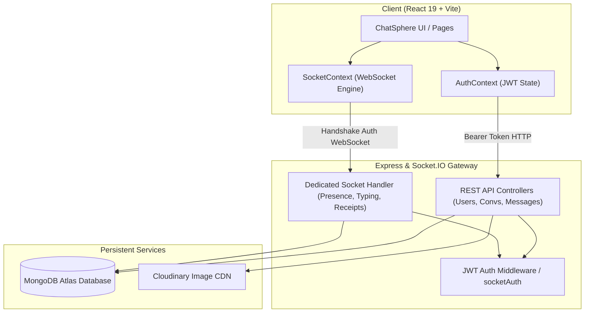

# 💬 ChatSphere — Real-Time Communication Platform

[](https://react.dev/)
[](https://vitejs.dev/)
[](https://nodejs.org/)
[](https://expressjs.com/)
[](https://www.mongodb.com/)
[](https://socket.io/)
[](https://cloudinary.com/)
[](https://opensource.org/licenses/MIT)

**ChatSphere** is a high-performance, intermediate-to-advanced real-time messaging web platform engineered using the **MERN** stack (MongoDB, Express, React, Node.js) and **Socket.IO**. Designed with production-grade coding practices, scalable MVC architecture, strict JWT-based socket and REST authorization, dynamic multi-device presence tracking, message delivery/read receipts, media sharing, and a responsive modern user interface.

---

## 🌟 Key Features

### 🔐 1. Authentication & Security
- **JWT & HTTP Authentication**: Stateless token generation with expiry verification.
- **Bcrypt Password Hashing**: Passwords are encrypted using 10 salt rounds before database persistence.
- **Handshake Socket Authentication**: Sockets are authenticated via JWT in the initial handshake; unauthenticated sockets are immediately rejected.
- **Protected Routing**: Global route guards (`ProtectedRoute`) ensuring unauthorized guests are redirected.
- **Password Management**: Change password and forgot/reset password token flows.
- **Sanitized Outputs**: Mongoose `.toJSON()` strips password and reset tokens from all responses.

### ⚡ 2. Real-Time Communication (Socket.IO)
- **Instant Messaging**: Real-time bi-directional message exchange between connected clients.
- **Multi-Device / Multi-Tab Synchronization**: In-memory `Map<userId, Set<socketId>>` supports multiple tabs per user without race conditions.
- **Presence Indicators**: Dynamic online/offline green status lights that update in real-time.
- **Typing Indicators**: Debounced `user_typing` and `user_stop_typing` events displaying `"${user} is typing..."` in header and bubble view.
- **Strict Room Isolation**: Server-side conversation membership validation prevents unauthorized room joins.

### 📬 3. Message Receipts & Unread Tracking
- **Three-Tier Status Receipts**:
  - `✓` **Sent**: Message saved in database.
  - `✓✓` **Delivered**: Recipient is online / connected.
  - `✓✓` **Read (Cyan/Blue)**: Recipient actively opened the conversation.
- **Unread Message Badges**: High-performance MongoDB Aggregation pipeline groups unread counts per conversation.
- **Dynamic Reordering**: Conversations automatically move to the top of the sidebar when a new message arrives.

### 📸 4. Media & Profile Sharing
- **Cloudinary Storage**: High-speed image uploads using `Multer.memoryStorage()` streamed directly to Cloudinary.
- **Development Fallback**: Optimized DataURI fallback ensures local development and tests run smoothly even without third-party credentials.
- **Attachment Previews**: Interactive preview box with cancel button before dispatching images.
- **Lightbox Viewer**: Clicking any image in chat expands into an animated full-screen lightbox modal.
- **User Profile Management**: Live avatar uploads, display name updates, and custom 160-character bio.

---

## 🏗️ System Architecture



---

## 🗄️ Database Design (Mongoose)

### 1. User Collection (`User.js`)
| Field | Type | Attributes | Description |
| :--- | :--- | :--- | :--- |
| `name` | String | Required, Trimmed | User's full display name |
| `email` | String | Required, Unique, Lowercase | User email for login |
| `password` | String | Required | Bcrypt salted hashed password |
| `profilePicture` | String | Default: `""` | Hosted Cloudinary URL or DataURI |
| `bio` | String | Max 160 chars | Custom user status / biography |
| `isOnline` | Boolean | Default: `false` | Real-time presence flag |
| `lastSeen` | Date | Default: `Date.now` | Timestamp of last disconnect |

### 2. Conversation Collection (`Conversation.js`)
| Field | Type | Attributes | Description |
| :--- | :--- | :--- | :--- |
| `participants` | `[ObjectId]` | Ref: `User` | Array of participant User IDs |
| `isGroup` | Boolean | Default: `false` | True for multi-user group conversations |
| `groupName` | String | Default: `""` | Name of group (if group) |
| `groupAdmin` | `ObjectId` | Ref: `User` | Group creator / admin ID |
| `lastMessage` | `ObjectId` | Ref: `Message` | Reference to latest message for previews |

### 3. Message Collection (`Message.js`)
| Field | Type | Attributes | Description |
| :--- | :--- | :--- | :--- |
| `conversation` | `ObjectId` | Ref: `Conversation`, Indexed | Associated conversation |
| `sender` | `ObjectId` | Ref: `User`, Required | Sender User ID |
| `text` | String | Trimmed | Text body of message |
| `image` | String | Default: `""` | Cloudinary CDN media URL |
| `messageType` | String | Enum: `["text", "image"]` | Type descriptor |
| `readBy` | `[ObjectId]` | Ref: `User`, Indexed | List of users who read the message |
| `deliveredTo` | `[ObjectId]` | Ref: `User` | List of users who received delivery |

---

## 📁 Project Structure

```text
ChatSphere/
├── backend/
│   ├── config/
│   │   └── db.js                       # MongoDB Atlas Mongoose connection
│   ├── controllers/
│   │   ├── authController.js           # Signup, login, profile, password reset
│   │   ├── userController.js           # Search, profile updates, avatar uploads
│   │   ├── conversationController.js   # 1-to-1 conversation management
│   │   └── messageController.js        # Send, history, read receipts, unread counts
│   ├── middleware/
│   │   ├── authMiddleware.js           # Bearer JWT route protector
│   │   ├── socketAuth.js               # Socket.IO handshake JWT authentication
│   │   ├── uploadMiddleware.js         # Multer 5MB memory storage filter
│   │   └── errorMiddleware.js          # Centralized error handler & payload guard
│   ├── models/
│   │   ├── User.js                     # User schema with sanitized toJSON
│   │   ├── Conversation.js             # Conversation schema
│   │   └── Message.js                  # Message schema with compound indexes
│   ├── routes/
│   │   ├── authRoutes.js               # /api/auth/*
│   │   ├── userRoutes.js               # /api/users/*
│   │   ├── conversationRoutes.js       # /api/conversations/*
│   │   └── messageRoutes.js            # /api/messages/*
│   ├── sockets/
│   │   └── socketHandler.js            # Real-time presence, typing & receipts
│   ├── utils/
│   │   └── cloudinary.js               # Cloudinary stream helper + local fallback
│   ├── .env.example
│   ├── package.json
│   └── server.js                       # Express bootstrap, 50MB limits & HTTP server
│
├── frontend/
│   ├── src/
│   │   ├── components/
│   │   │   ├── ProtectedRoute.jsx      # Navigation guard wrapper
│   │   │   ├── Sidebar.jsx             # Search, live chats, unread badges, footer
│   │   │   └── UserProfile.jsx         # Profile details modal, avatar & password
│   │   ├── context/
│   │   │   ├── AuthContext.jsx         # Global auth state & session verification
│   │   │   └── SocketContext.jsx       # Single WebSocket lifecycle & online tracking
│   │   ├── hooks/
│   │   │   ├── useAuth.js              # Custom hook for AuthContext
│   │   │   └── useSocket.js            # Custom hook for SocketContext
│   │   ├── pages/
│   │   │   ├── Login.jsx               # Login page
│   │   │   ├── Signup.jsx              # Signup page
│   │   │   └── Chat.jsx                # Messages, photo attachment, receipts, typing
│   │   ├── services/
│   │   │   ├── api.js                  # Axios instance with Bearer interceptor
│   │   │   └── socket.js               # Socket instance helper
│   │   ├── App.jsx                     # Router & dashboard composition
│   │   ├── main.jsx                    # Root provider mounting
│   │   └── index.css                   # Responsive typography & component styles
│   ├── .env.example
│   ├── package.json
│   └── vite.config.js
└── README.md
```

---

## 📡 REST API Documentation

| Method | Endpoint | Auth | Description |
| :--- | :--- | :---: | :--- |
| `POST` | `/api/auth/signup` | Public | Create new account with name, email, password |
| `POST` | `/api/auth/login` | Public | Authenticate user & return JWT token |
| `GET` | `/api/auth/profile` | 🔒 Yes | Validate session & retrieve current user profile |
| `PUT` | `/api/auth/profile` | 🔒 Yes | Update display name and bio |
| `POST` | `/api/auth/change-password` | 🔒 Yes | Verify current password and set new password |
| `POST` | `/api/auth/forgot-password` | Public | Generate password reset token |
| `POST` | `/api/auth/reset-password` | Public | Reset password using valid reset token |
| `GET` | `/api/users/search?query=name` | 🔒 Yes | Case-insensitive regex user search |
| `GET` | `/api/users/:id` | 🔒 Yes | Fetch specific user information |
| `PUT` | `/api/users/profile` | 🔒 Yes | Update profile information |
| `POST` | `/api/users/profile-picture` | 🔒 Yes | Upload avatar via Multer to Cloudinary |
| `GET` | `/api/conversations` | 🔒 Yes | Fetch all conversations sorted by latest update |
| `POST` | `/api/conversations` | 🔒 Yes | Create or open existing 1-on-1 conversation |
| `GET` | `/api/messages/:conversationId` | 🔒 Yes | Fetch message history for authorized participant |
| `POST` | `/api/messages/send` | 🔒 Yes | Post message (text, image, or both) & broadcast |
| `POST` | `/api/messages/upload` | 🔒 Yes | Upload media attachment for chat |
| `PUT` | `/api/messages/read/:conversationId`| 🔒 Yes | Mark all unread messages in conversation as read |
| `GET` | `/api/messages/unread-count` | 🔒 Yes | Grouped unread message counts per conversation |

---

## 🔌 Socket.IO Events

| Event Name | Direction | Payload | Description |
| :--- | :---: | :--- | :--- |
| `connection` | Client ➔ Server | Handshake `{ auth: { token } }` | Authenticates socket connection |
| `get_online_users` | Server ➔ Client | `[userId1, userId2, ...]` | List of currently active user IDs |
| `user_online` | Server ➔ Client | `{ userId }` | Broadcasted when a user connects |
| `user_offline` | Server ➔ Client | `{ userId, lastSeen }` | Broadcasted when user disconnects all tabs |
| `join_conversation`| Client ➔ Server | `conversationId` | Validates participant & joins room |
| `leave_conversation`| Client ➔ Server | `conversationId` | Leaves conversation room |
| `typing` | Client ➔ Server | `{ conversationId }` | Notifies that user started typing |
| `user_typing` | Server ➔ Client | `{ conversationId, userName }` | Broadcast to room except sender |
| `stop_typing` | Client ➔ Server | `{ conversationId }` | Notifies user stopped typing |
| `user_stop_typing` | Server ➔ Client | `{ conversationId }` | Broadcast to room to clear indicator |
| `new_message` | Server ➔ Client | `messageDocument` | Real-time message delivered to room |
| `mark_messages_read`| Client ➔ Server | `{ conversationId }` | Updates read status in MongoDB |
| `messages_read` | Server ➔ Client | `{ conversationId, readerId }`| Signals sender to turn checkmarks blue |

---

## 🚀 Getting Started

### Prerequisites
- [Node.js (v18+)](https://nodejs.org/)
- [MongoDB Atlas](https://www.mongodb.com/) account or local MongoDB instance

### 1. Clone Repository
```powershell
git clone https://github.com/your-username/ChatSphere.git
cd ChatSphere
```

### 2. Backend Setup
```powershell
cd backend
npm install
```
Create a `.env` file in `backend/` (refer to `backend/.env.example`):
```env
PORT=5000
MONGO_URI=your_mongodb_connection_string
JWT_SECRET=your_super_secret_jwt_key
CLOUDINARY_CLOUD_NAME=your_cloudinary_cloud_name
CLOUDINARY_API_KEY=your_cloudinary_api_key
CLOUDINARY_API_SECRET=your_cloudinary_api_secret
```
Start the backend dev server:
```powershell
npm run dev
```

### 3. Frontend Setup
Open a new PowerShell terminal:
```powershell
cd ..\frontend
npm install
npm run dev
```
Open `http://localhost:5173` in your browser.

---

## 🛡️ Security Best Practices Implemented

- **Handshake Verification**: Sockets never trust client-provided IDs; identity is extracted directly from verified JWT tokens on the server.
- **Room Authorization**: Users cannot eavesdrop on conversations by emitting arbitrary room IDs; server validates participant membership before allowing room entrance.
- **Payload & DoS Defense**: Express JSON body size is explicitly governed, and file uploads are strictly limited to valid image MIME types with a 5MB threshold.
- **NoSQL Injection Defense**: Regex searches escape all special meta-characters (`/[.*+?^${}()|[\]\\]/g`).

---

## 🎓 Resume Highlights & Interview Discussion Points

```markdown
- Architected a real-time messaging application with React 19, Node.js, Express, and Socket.IO, handling concurrent real-time connections with sub-100ms latency.
- Implemented robust multi-tab presence tracking using in-memory Maps and database fallbacks, broadcasting accurate online/offline states across client pools.
- Designed comprehensive three-tier message status receipts (Sent, Delivered, Read) with real-time UI synchronization using Socket.IO room events.
- Built scalable media pipeline using Multer memory storage and Cloudinary CDN streaming, eliminating raw file storage in MongoDB documents.
- Created reusable state architecture using React Context API (`AuthContext`, `SocketContext`), custom hooks (`useAuth`, `useSocket`), and route guards.
```

---

## 📄 License
This project is open-source and available under the [MIT License](LICENSE).

